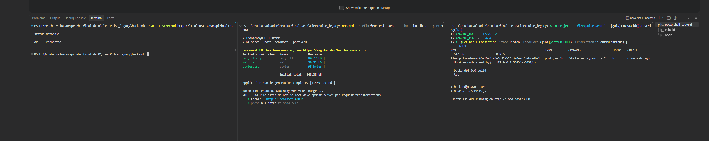
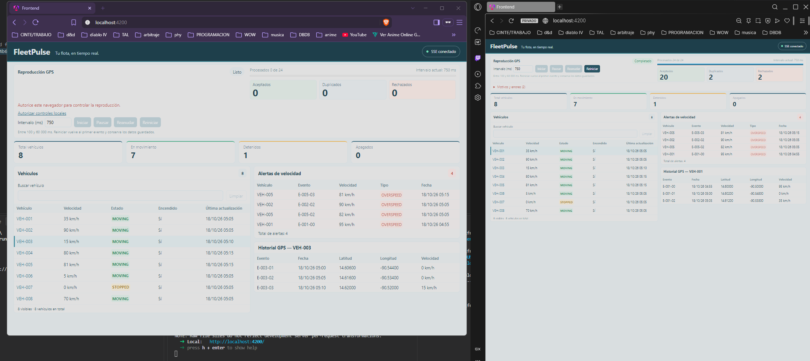
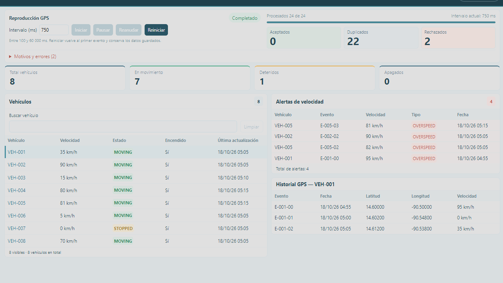
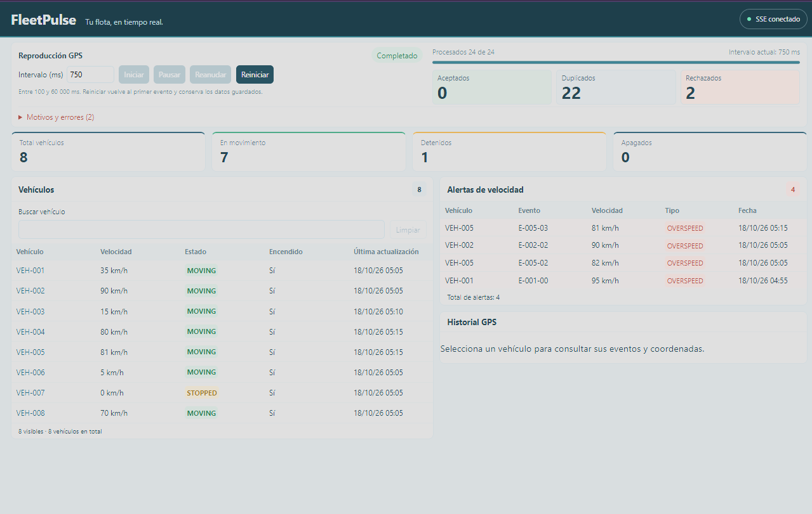
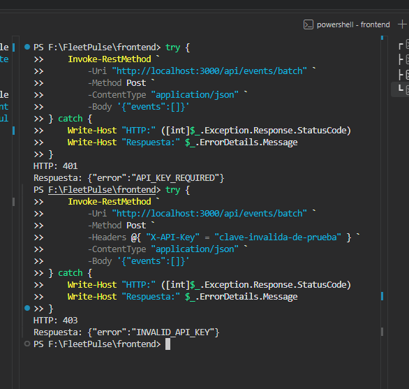
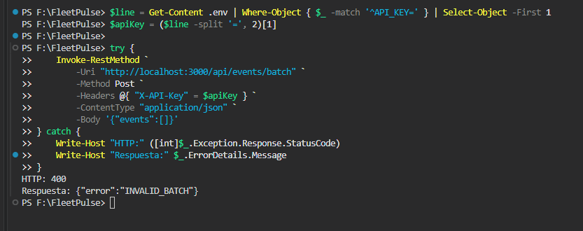
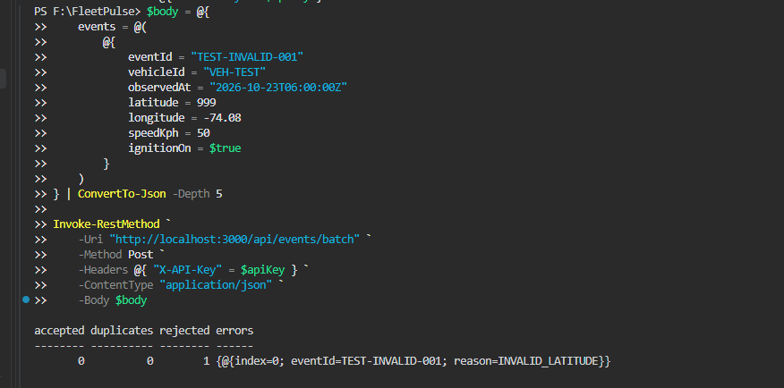
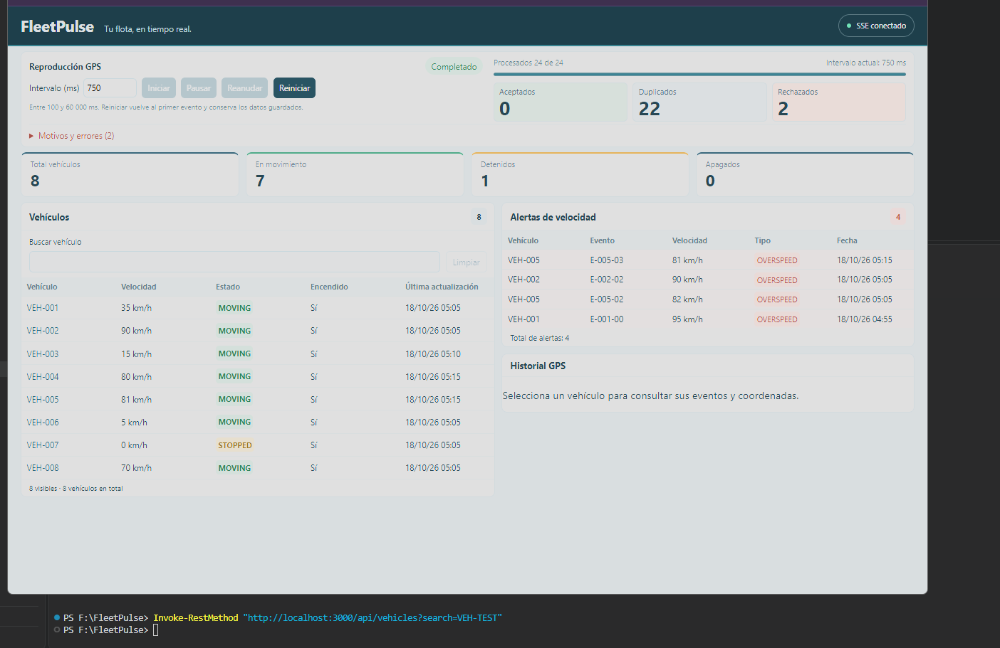
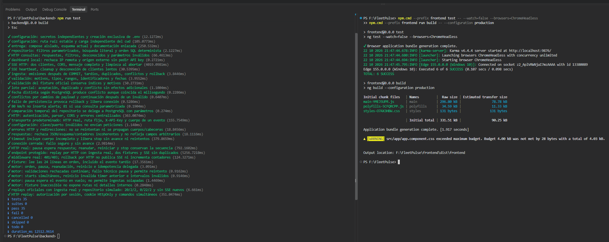
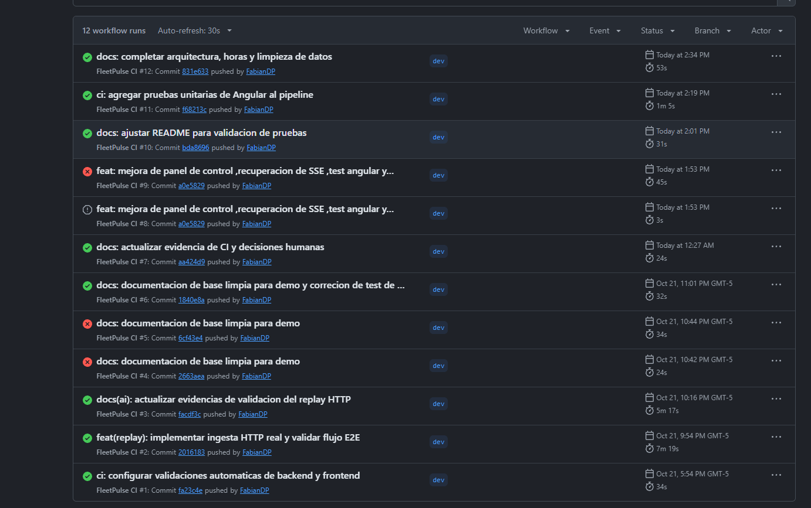

# FleetPulse — Evidencias de pruebas

Este documento reúne las verificaciones manuales y automatizadas realizadas durante el desarrollo de FleetPulse. Las capturas corresponden a ejecuciones observadas; los resultados de CI reflejan la rama `dev` al momento de tomar la evidencia.

## 1. Instalación limpia y arranque

**Objetivo:** verificar que el proyecto se pueda clonar, configurar y ejecutar siguiendo el README.

**Resultado observado:** PostgreSQL iniciado mediante Docker Compose y saludable, backend en `http://localhost:3000`, frontend en `http://localhost:4200` y endpoint `/api/health` con `status: ok` y `database: connected`.

**Observación:** durante la prueba se detectó que la variable de PowerShell `$demoProject` no se conserva al abrir otra sesión. Se debe indicar en el README cómo recuperar el nombre exacto antes de ejecutar la limpieza de volúmenes.

## 2. SSE con dos clientes simultáneos

**Objetivo:** comprobar que dos navegadores conectados reciben actualizaciones del mismo backend sin recargar la página y conservan su selección local de vehículo.

**Resultado observado:** ambos navegadores mostraron `SSE conectado`. Un navegador controló el replay y el otro recibió las actualizaciones; se consultaron historiales de VEH-001 y VEH-003 de forma independiente. En la captura de la primera reproducción se observan 24 eventos procesados, 20 aceptados, 2 duplicados y 2 rechazados.

## 3. Idempotencia y persistencia — segunda reproducción

**Objetivo:** volver a reproducir el mismo fixture sin limpiar la base de datos.

| Indicador | Esperado | Observado |
|---|---:|---:|
| Procesados | 24 | 24 |
| Aceptados | 0 | 0 |
| Duplicados | 22 | 22 |
| Rechazados | 2 | 2 |
| Vehículos persistidos | 8 | 8 |
| Alertas persistidas | 4 | 4 |

**Resultado:** la segunda reproducción no generó nuevos vehículos ni alertas; el historial GPS continuó disponible.

## 4. Dashboard y datos persistidos

**Objetivo:** verificar visualización de vehículos, estados y alertas de velocidad.

**Resultado observado:** 8 vehículos, 7 en movimiento, 1 detenido, 0 apagados y 4 alertas de exceso de velocidad.

## 5. Autenticación de API — sin clave y clave incorrecta

**Endpoint:** `POST /api/events/batch`.

| Caso | HTTP observado | Respuesta |
|---|---:|---|
| Sin `X-API-Key` | 401 | `API_KEY_REQUIRED` |
| `X-API-Key` incorrecta | 403 | `INVALID_API_KEY` |

## 6. Validación de lote vacío

**Objetivo:** comprobar que una API Key válida no permite enviar un lote sin eventos.

**Resultado observado:** HTTP 400, `INVALID_BATCH`, para `{"events":[]}`.

## 7. Validación de coordenadas GPS

**Objetivo:** rechazar un evento con latitud fuera de rango (`latitude: 999`).

**Resultado observado:** 0 aceptados, 0 duplicados, 1 rechazado, motivo `INVALID_LATITUDE`.

## 8. Verificación de que el evento inválido no creó un vehículo

**Objetivo:** comprobar que el vehículo de prueba `VEH-TEST` no se incorporó a los datos persistidos.

**Resultado observado:** la consulta `GET /api/vehicles?search=VEH-TEST` no mostró registros en PowerShell; el dashboard conservó 8 vehículos y 4 alertas.

## 9. Pruebas automatizadas y compilación

**Resultado observado en terminal local:**

- Backend: **35 tests aprobados**, 0 fallidos.
- Frontend Angular: **6 tests aprobados**, 0 fallidos.
- Compilación de producción del frontend completada.
- **Advertencia no bloqueante:** el presupuesto CSS de `app.component.css` se excedió por 28 bytes (4.03 kB frente a 4.00 kB).

## 10. Integración continua (GitHub Actions)

**Resultado observado:** las tres ejecuciones más recientes mostradas en la captura de la rama `dev` finalizaron correctamente. La imagen también contiene ejecuciones anteriores fallidas durante el desarrollo.

**Verificación pendiente para la entrega:** confirmar que el commit y la rama finales tengan su ejecución de CI aprobada.

---

## Notas de reproducibilidad

- Los pasos de instalación y ejecución se encuentran en el [README](../README.md).
- El botón **Reiniciar** del replay reinicia su progreso, pero **no elimina datos persistidos**.
- Para repetir una primera reproducción sobre una base limpia, utilizar un proyecto Docker Compose aislado y seguir la limpieza segura documentada en el README.
